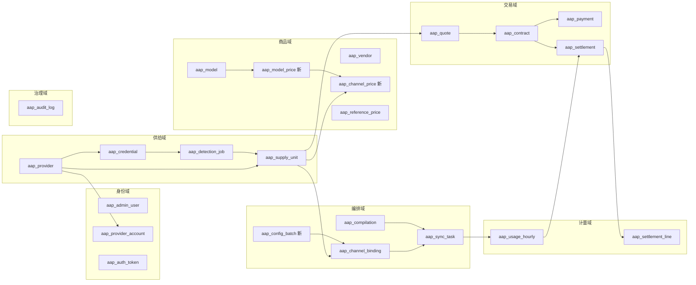
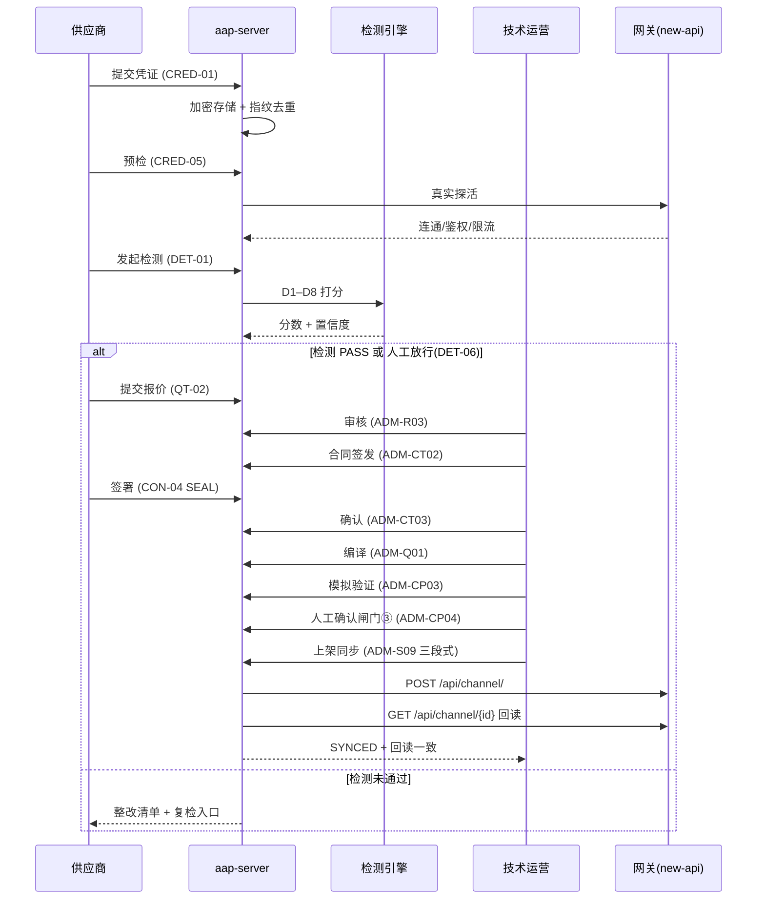
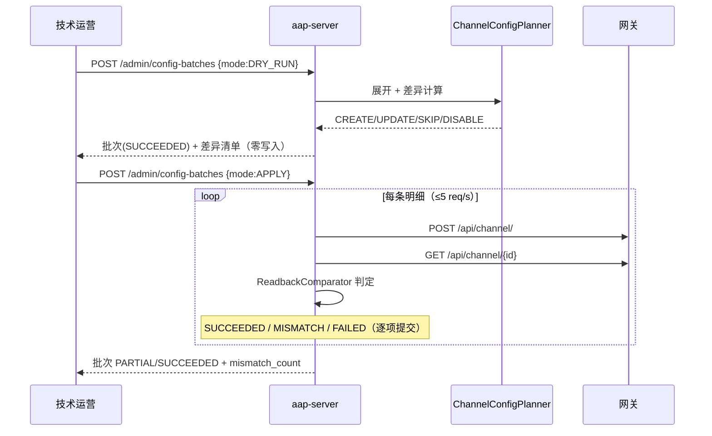
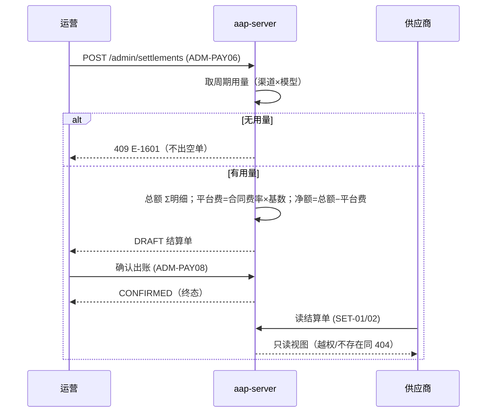
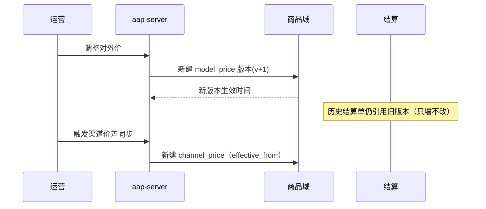

# 02 · 全局 ER 模型 · 核心时序 · API 增量

> 对象域设计的核心：**每域单一写入口，跨域只读**。
> 现状：59 张表、117 个端点（`docs/backend/endpoints.json` 为冻结契约）。

## 1. 全局对象域视图

## 2. 关键实体与不变量

| 域 | 实体 | 主键/唯一 | 关键不变量 |
|---|---|---|---|
| 供给 | `aap_provider` | USCC 唯一 | 状态机 DRAFT→…→PUBLISHED；PUBLISHED 才可上架 |
| 供给 | `aap_credential` | `(provider_id, api_key_fingerprint)` 唯一 | key 只存密文+指纹+掩码；`detection_status='PASS'` 才可用于生产路由 |
| 供给 | `aap_supply_unit` | `(provider_id, model_name)` 唯一 | **= 模型 × 供应商**；是「一模型一渠道」的聚合根；`granularity` 决定单模型/合并 |
| 商品 | `aap_model_price` **新** | `(model_id, version)` 唯一 | **只增不改**；对外价变更生成新版本；历史账单引用旧版本 |
| 商品 | `aap_channel_price` **新** | `(supply_unit_id, effective_from)` 唯一 | 采购价必须可回溯到 `quote_id` 或 `contract_id` |
| 编排 | `aap_channel_binding` | `(supply_unit_id)` 唯一（PER_MODEL） | `channel_name` = `AAP-{short_code}-{model}`，≤64 字符，可反解 |
| 编排 | `aap_config_batch` **新** | `batch_no` 唯一 | dry-run 必须零上游写入；apply 必须逐项独立提交 |
| 编排 | `aap_config_batch_item` **新** | `idempotency_key` 唯一 | 单项失败不回滚已成功项（R-59） |
| 交易 | `aap_settlement` | `(provider_id, statement_month)` 唯一 | 同周期幂等；无用量不出空单；出账后终态 |
| 计量 | `aap_usage_hourly` | `(provider_id, channel_id, model_name, stat_hour)` 唯一 | 归集幂等，可重跑 |

## 3. 核心时序（4 个关键流程）

### 3.1 进件到上架（主链路）

### 3.2 批量配置（dry-run → apply）

### 3.3 结算出账

### 3.4 价格变更（版本化）

## 4. API 增量（按域，均需先改生成器再重生成）

| 域 | 端点 | 方法 | 说明 | 状态 |
|---|---|---|---|---|
| 供给 | `/admin/supply-units` | GET | 供给单元列表（供应商/模型/状态） | ✅ 已有 |
| 供给 | `/admin/supply-units/{id}` | GET | 详情 | ✅ |
| 供给 | `/admin/supply-units/{id}/reconfigure` | POST | 重配置（默认 dry-run） | ✅ |
| 供给 | `/admin/supply-units/{id}/offline` | POST | 下线 | ✅ |
| 编排 | `/admin/config-batches` | POST/GET | 批次创建/列表 | ✅ |
| 编排 | `/admin/config-batches/{id}` | GET | 详情（含明细与 mismatch） | ✅ |
| 编排 | `/admin/config-batches/{id}/items/{itemId}/retry` | POST | 单模型重试 | ✅ |
| 编排 | `/admin/config-batches/{id}/items/{itemId}/rollback` | POST | 单模型回滚 | ✅ |
| 商品 | `/admin/model-prices` | GET/POST | 模型价格（版本化） | 🆕 待加 |
| 商品 | `/admin/model-prices/{modelId}/versions` | GET | 价格版本历史 | 🆕 |
| 商品 | `/admin/channel-prices` | GET/POST | 渠道价格（采购视角） | 🆕 |
| 商品 | `/admin/pricing/matrix` | GET | 比价矩阵 | 🆕 |
| 商品 | `/admin/pricing/margin` | GET | 毛利视图 | 🆕 |
| 商品 | `/admin/pricing/coverage` | GET | 供给覆盖（断供风险） | 🆕 |
| 进件 | `/admin/intake/policies` | GET/PUT | L0–L3 分级策略 | 🆕 |
| 进件 | `/admin/intake/tasks/{id}/approve` | POST | 人工放行/驳回 | 🆕 |
| 客户端 | `/client/models` | GET | 模型浏览（对外价） | 🆕 |
| 客户端 | `/client/keys` | GET/POST/DELETE | API Key 自助 | 🆕 |
| 客户端 | `/client/usage` | GET | 用量/账单 | 🆕 |
| 客户端 | `/client/invoices` | GET | 发票/合同下载 | 🆕 |

**新增表（P2 规划）**：`aap_model_price`、`aap_channel_price`、`aap_intake_policy`、`aap_client_account`、`aap_client_key`（V17+）。迁移需同步 `MigrationTest` 与 ER 文档（双向门禁）。

## 5. 域间契约（防跨域写）

| 调用方 | 被调方 | 允许方式 | 禁止 |
|---|---|---|---|
| 编排域 | 商品域 | 只读价格（当前生效版本） | 直接改价格表 |
| 计量域 | 编排域 | 只读渠道/模型映射 | 改绑定 |
| 交易域 | 计量域 | 只读用量聚合 | 改用量原始数据 |
| 客户端 | 编排域 | ❌ 不直连 | 暴露 channel_id / 成本价 |
| 所有域 | 治理域 | 只写审计 | 跳过审计 |

## 6. 与现状的差异（需在 P5 原型中体现）

1. **价格双轨**：现有只有 `aap_reference_price`（参考价），缺「平台对外价（版本化）」与「采购价（可回溯合同）」。
2. **编排可观测**：现有同步任务有，但缺**批量差异预演**的运营界面（后端已就绪）。
3. **客户端缺失**：整个需求侧（模型浏览/Key/账单）尚无端点与界面。
4. **进件分级缺失**：L0–L3 只有规格，无策略配置与审批界面。
